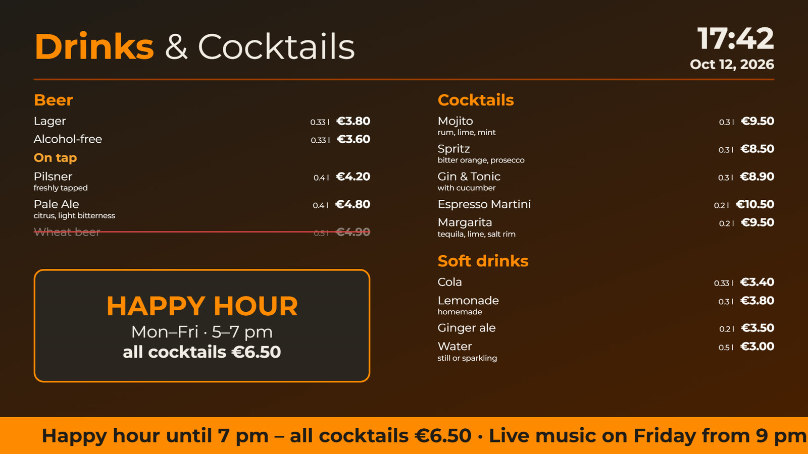
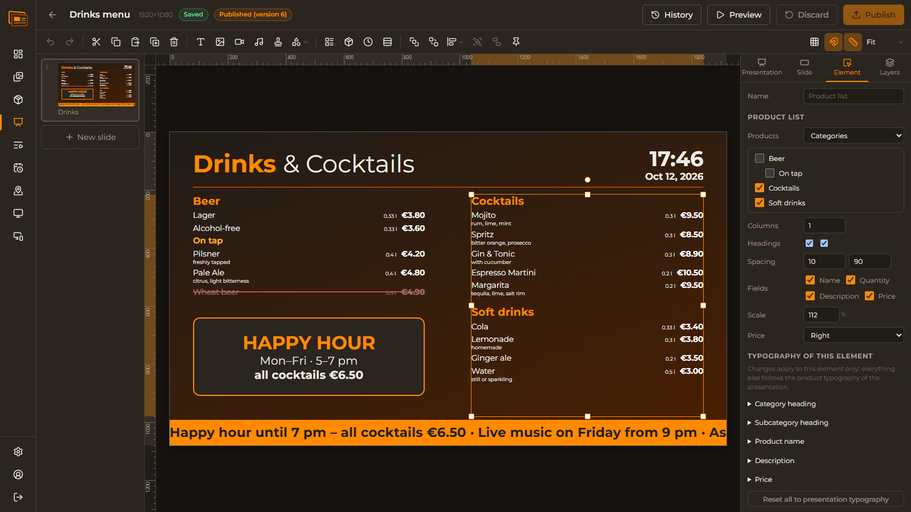
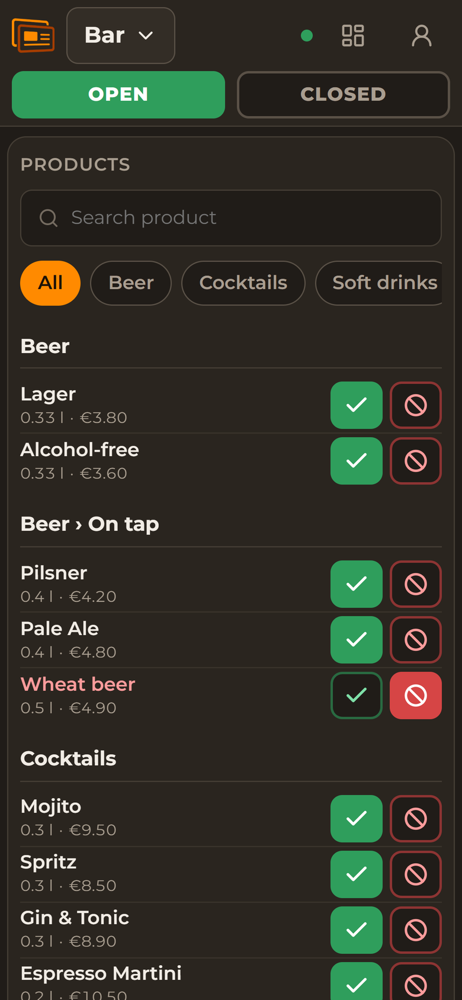
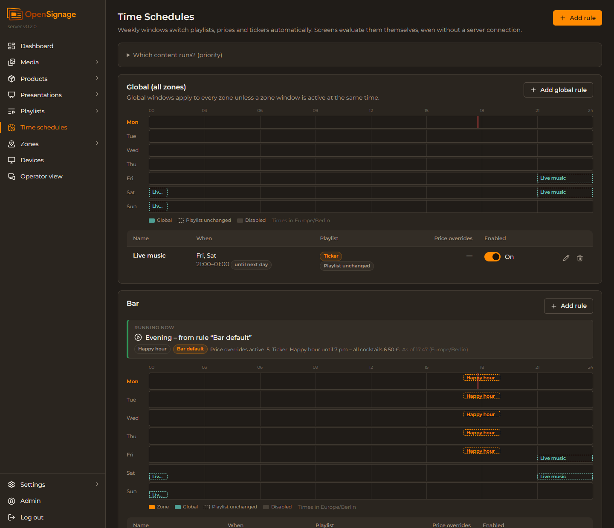
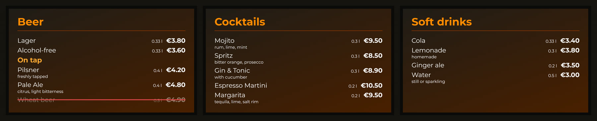

<p align="center">
  
</p>

<p align="center">
  <b>Self-hosted digital signage for bars, restaurants and events.</b><br>
  Drink menus with live prices and sold-out status, event slides and videos on any number of
  screens – managed from your own server, on site or in a data centre, played on Raspberry Pi
  and small PCs, without any third-party cloud.
</p>

<p align="center">
  
</p>

## What it is for

A bar wants its drinks menu on the screens behind the counter, the prices of the happy hour
at five o'clock, the sold-out cocktail off the menu within a second, and the next event
announced on the terrace – without a cloud subscription, without internet at the counter and
without a technician.

OpenSignage does exactly that:

- **One server** – usually in the local network: a small PC, a virtual machine or a
  Raspberry Pi. It holds the content, the products and the time schedules and serves the web
  interface.
- **One player per screen** – a Raspberry Pi 4 or a small x86 PC behind the screen. It finds
  the server by itself, keeps all content locally and keeps playing when the server or the
  internet is gone.
- **Any browser** – the administration on a computer, the operator view on a tablet or
  phone at the bar.

**Local first, but not local only.** OpenSignage is built to run on site and completely
offline. The server can just as well run on your own server in a data centre or a cloud VM:
the players then connect over the internet – through a VPN or directly – for example several
locations on one server, each with its own zones and operators. If the connection breaks,
every screen keeps playing its local copy, time schedules included.

Everything is open source (AGPL-3.0) and available in the 24 official EU languages.

## What it can do

### Design screens in the browser



- A presentation editor like Impress or PowerPoint: text with rich formatting, images, videos,
  audio, shapes, clock, ticker – and **product lists** that show categories, quantities and
  prices straight from the product database.
- Any design resolution (landscape, portrait, 4K); screens scale it sharply.
- Backgrounds (colour, gradient, image, video), transitions, pinned elements, layers, rulers,
  guides, snapping, undo/redo, version history.
- The editor and the players use the same rendering engine: the screen shows exactly what
  the preview shows.
- Nothing reaches the screens before you **publish** it.

### Change things live from the bar



- The **operator view** runs on any phone or tablet: switch a product to *sold out* and every
  screen of the zone greys it out with a red bar – in under a second.
- Open or close a zone: CLOSED shows its own playlist (e.g. "We're closed – see you
  tomorrow").
- Operators only see the zones they are responsible for; every switch is confirmed and
  logged.
- Administrators can take an item off the menu completely ("not available") – it disappears
  without leaving a gap.

<br clear="right">

### Let the clock do the work



- **Time schedules** switch playlists, **prices** (happy hour) and **tickers** by weekday and
  time – per zone or for all zones, windows across midnight included.
- A rule changes only what it sets, so the happy hour prices and the live-music ticker can
  overlap.
- "Running now" shows for every zone and group what is playing and why.
- Every player evaluates the schedule itself: switches happen on time even when the server
  is offline.

### Many screens, one picture



- All screens of a zone change slides **at the same moment** – with or without the server;
  a screen switched on later joins in the middle of the sequence.
- **Display groups** with numbered places turn three screens into one menu wall: one
  playlist with a track per screen.
- Players keep their clocks in step with the server, and with each other in the LAN when
  the server is not reachable.

### Players that look after themselves

- Install a player with one line, give it a name, type the PIN shown on the screen into the
  administration – done. Players find the server in the LAN by themselves; in other
  networks they get its address or host name.
- Wired network and Wi-Fi are set up in the player's own web interface: DHCP or a fixed
  address, Wi-Fi networks found by a scan, signal strength. A change only stays once you
  log in again at the new address – a restart undoes a wrong setting.
- Hardware video decoding on the Raspberry Pi and on Intel graphics; videos are converted on
  upload so every player gets a version it can play smoothly.
- A crashed browser, a hanging video or lost graphics acceleration are detected and fixed
  automatically. Problems (offline, low disk space, under-voltage …) show up in the
  administration.
- Display mode, rotation and scaling are set remotely; screenshot, reload, restart and
  blackout from the device page; plasma protection and regeneration for plasma screens.

### Safe to run for years

- **Signed updates** from GitHub or an uploaded file. The server backs up its database,
  updates itself and rolls back by itself if anything fails; then it updates the players
  one per zone at a time. Nothing installs without a click.
- HTTPS without a domain (local certificate authority), roles and audit log, backup and
  restore, storage overview, trash for media.
- No third-party cloud, no tracking, no CDN: the players only ever talk to your own server.

## How it works

```
  Browser (admin, editor)          Tablet / phone (operator view)
             │  HTTPS 443                    │  HTTPS 443
             └──────────────┬────────────────┘
                     ┌──────┴──────┐
                     │   Server    │  content · products · schedules · updates
                     └──────┬──────┘
                            │  device channel 7443 (pinned TLS), discovery 7444/udp
           ┌────────────────┼────────────────┐
     ┌─────┴─────┐    ┌─────┴─────┐    ┌─────┴─────┐
     │  Player   │    │  Player   │    │  Player   │   Chromium kiosk, local cache,
     │ (Pi 4/PC) │    │ (Pi 4/PC) │    │ (Pi 4/PC) │   own schedule evaluation
     └───────────┘    └───────────┘    └───────────┘
```

The server is one Go program with an embedded web interface and a SQLite database. Each
player runs a small Go agent that controls Chromium in kiosk mode without a desktop. The
server does not have to be in the same network: players reach it by address or host name
over a VPN or directly over the internet (port 7443, TLS with the server key pinned at
pairing and a token per device). Details: [ARCHITECTURE.md](ARCHITECTURE.md).

## Installation

One line on the server, one line on every player:

```bash
curl -fsSL https://raw.githubusercontent.com/testbild-media/OpenSignage/main/install.sh | sh -s -- server
curl -fsSL https://raw.githubusercontent.com/testbild-media/OpenSignage/main/install.sh | sh -s -- player --name "Bar north"
```

The script downloads the newest release, **checks its signature** and checksum, and only
then runs the installer. Then open `https://<server-ip>/`, create the first administrator
and take the players over with the PIN shown on their screens. Nothing has to be built.

Step by step, manual installation, certificates and hardware notes:
[docs/installation.md](docs/installation.md).

### Supported hardware

| | |
| --- | --- |
| **Server** | Debian 12/13 or Raspberry Pi OS (64-bit); amd64 or arm64 |
| **Players** | **Recommended:** small x86 PCs with Intel graphics (Debian), up to 4K. **Minimum:** Raspberry Pi 4 (Raspberry Pi OS 64-bit Lite) |
| **Operator view** | any current browser on phones, tablets and computers |

Raspberry Pi 3 and 2 are **not supported**: their hardware video decoder fails about every
15–20 minutes when videos change often. It may work with simple content, but it is not
recommended. AMD and Nvidia graphics and the Raspberry Pi 5 are not tested yet.

## Documentation

- [Installation](docs/installation.md) – server, players, certificates, server in a data centre, hardware
- [User guide](docs/user-guide.md) – zones, content, playlists, schedules, live operation, devices
- [Architecture](ARCHITECTURE.md) – components, protocols, contracts, storage
- [Development](docs/development.md) – building from source, checks, translations, releases
- [Changelog](CHANGELOG.md)

## License

OpenSignage is licensed under the **GNU Affero General Public License v3.0 or later**
([LICENSE](LICENSE)). Bundled fonts and libraries keep their own free licenses (SIL OFL 1.1,
Apache 2.0, MIT, BSD, ISC); see [THIRD_PARTY_LICENSES.md](THIRD_PARTY_LICENSES.md) and
[fonts/LICENSES.md](fonts/LICENSES.md).
